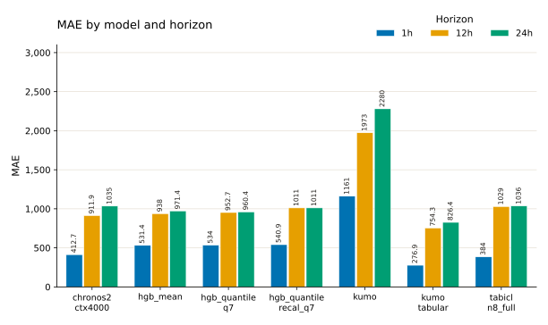
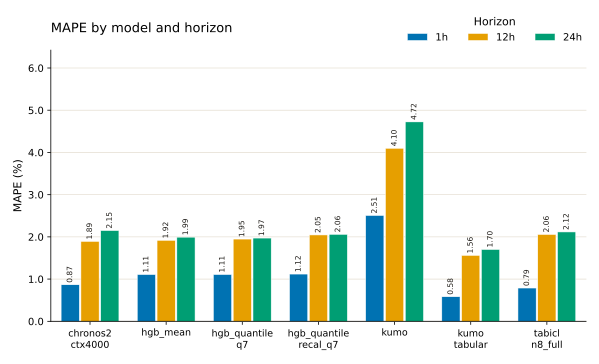
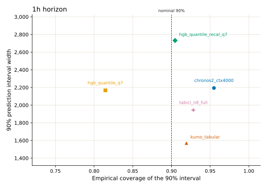
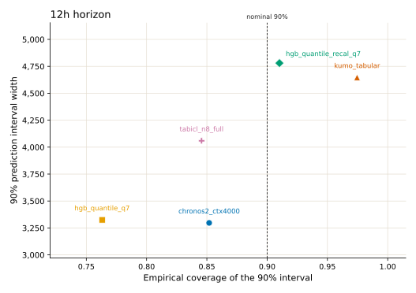
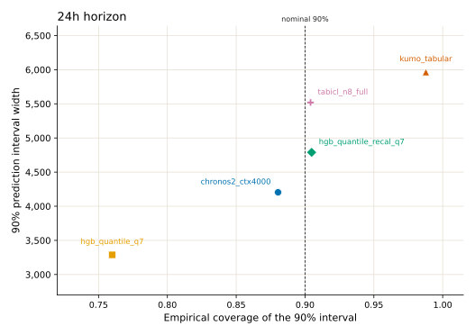
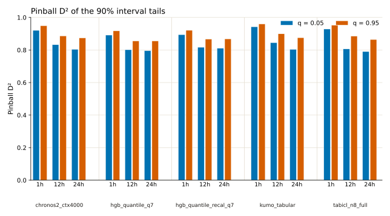

# Walk-forward CV metric plots

These figures restate the pooled metrics from the [walk-forward CV comparison](https://probabl-ai.github.io/skore-example-electricity-load/model-comparison/cv_comparison/report.html). Each number pools every row across the 8 CV folds. MAE and MAPE use the median prediction where the model has quantiles. Coverage, interval width, and pinball D² use the published quantiles. `hgb_mean` and `kumo` have no quantiles in that table, so they appear only in the point-error plots.

The plots show the 1h, 12h, and 24h horizons. The source table also reports an average slice; those values are in the tables below.

## Source revision

The published table was revised on 2026-11-02. Compared with the earlier snapshot (2026-10-30), these values changed:

- `kumo_tabular` point metrics (MAE, MAPE), 90% coverage, and 90% interval width, at every horizon.
- Pinball D² at q = 0.05 and q = 0.95 for every quantile model (`chronos2_ctx4000`, `hgb_quantile_q7`, `hgb_quantile_recal_q7`, `kumo_tabular`, `tabicl_n8_full`), at every horizon.
- Pinball D² at q = 0.5 for `kumo_tabular` only.

The MAE, MAPE, coverage, and width of the other four quantile models did not change. Neither did the median D² of those models. The revision does not say why the tail D² values moved. The figures and tables here use the 2026-11-02 values. The earlier values are in the git history of `data/cv_metrics.json`.

MAE and interval width are in the load units of the source table. The MAPE figure shows percent; the tables keep the source fractions.

## Point error

`kumo_tabular` has the lowest MAE and MAPE at 1h, 12h, and 24h. At 1h its MAE is 276.9, ahead of `tabicl_n8_full` (384) and `chronos2_ctx4000` (412.7). The three histogram gradient boosting models sit together at 1h (531.4 to 540.9). `kumo` is about four times that, at 1161.

At 12h `kumo_tabular` is at 754.3, and the next model is `chronos2_ctx4000` at 911.9. At 24h its MAE is 826.4, then `hgb_quantile_q7` at 960.4, `hgb_mean` at 971.4, and `hgb_quantile_recal_q7` at 1011. `chronos2_ctx4000` (1035) and `tabicl_n8_full` (1036) are next to each other. `kumo` is 2280.

Recalibrating the quantile model raises MAE at every horizon: `hgb_quantile_recal_q7` versus `hgb_quantile_q7` is 540.9 versus 534 at 1h, 1011 versus 952.7 at 12h, and 1011 versus 960.4 at 24h.

MAPE orders the models the same way as MAE at 1h and 12h. At 24h `chronos2_ctx4000` and `tabicl_n8_full` swap places: `tabicl_n8_full` has the lower MAPE (2.12% versus 2.15%), while `chronos2_ctx4000` has the lower MAE (1035 versus 1036).





### MAE

| model | 1h | 12h | 24h | average |
| --- | ---: | ---: | ---: | ---: |
| chronos2_ctx4000 | 412.7 | 911.9 | 1035 | 786.6 |
| hgb_mean | 531.4 | 938 | 971.4 | 813.6 |
| hgb_quantile_q7 | 534 | 952.7 | 960.4 | 815.7 |
| hgb_quantile_recal_q7 | 540.9 | 1011 | 1011 | 854.2 |
| kumo | 1161 | 1973 | 2280 | 1805 |
| kumo_tabular | 276.9 | 754.3 | 826.4 | 619.2 |
| tabicl_n8_full | 384 | 1029 | 1036 | 816.2 |

### MAPE

| model | 1h | 12h | 24h | average |
| --- | ---: | ---: | ---: | ---: |
| chronos2_ctx4000 | 0.008655 | 0.01892 | 0.02148 | 0.01635 |
| hgb_mean | 0.01107 | 0.01917 | 0.01993 | 0.01672 |
| hgb_quantile_q7 | 0.01108 | 0.01948 | 0.01971 | 0.01676 |
| hgb_quantile_recal_q7 | 0.01119 | 0.02046 | 0.0206 | 0.01742 |
| kumo | 0.02506 | 0.04098 | 0.04723 | 0.03776 |
| kumo_tabular | 0.00582 | 0.0156 | 0.01702 | 0.01281 |
| tabicl_n8_full | 0.007879 | 0.02057 | 0.02117 | 0.01654 |

## Interval width and coverage

On these plots a calibrated sharp 90% interval sits on the dashed line and low on the width axis. Each panel has its own width scale, because interval width grows with the horizon.

At 1h, `kumo_tabular` has the narrowest interval (1571) and slightly overcovers (0.919). `tabicl_n8_full` overcovers a bit more (0.928) at width 1944. `hgb_quantile_q7` undercovers (0.815) at a width close to Chronos-2 (2167 versus 2194). Recalibration moves that model to 0.905 and widens the interval to 2732. Chronos-2 overcovers (0.955) at width 2194.

At 12h, `chronos2_ctx4000` and `hgb_quantile_q7` have the narrowest intervals (3297 and 3325), and both undercover (0.852 and 0.763). `tabicl_n8_full` undercovers as well (0.846) at width 4059. Recalibration reaches 0.910 at width 4780. `kumo_tabular` overcovers (0.975) at width 4647.

At 24h, `hgb_quantile_q7` is again the narrowest (3288) and the furthest under the nominal coverage (0.760). Chronos-2 is closer to the line (0.880) at width 4204. Recalibration lands on 0.905 at width 4789, and `tabicl_n8_full` is on the nominal coverage (0.904) at width 5519. `kumo_tabular` overcovers (0.988) with the widest interval (5964).







### Coverage of the 90% interval

| model | 1h | 12h | 24h | average |
| --- | ---: | ---: | ---: | ---: |
| chronos2_ctx4000 | 0.9549 | 0.8519 | 0.8804 | 0.8957 |
| hgb_quantile_q7 | 0.8146 | 0.7631 | 0.7599 | 0.7792 |
| hgb_quantile_recal_q7 | 0.9047 | 0.9102 | 0.9048 | 0.9066 |
| kumo_tabular | 0.9193 | 0.9746 | 0.9878 | 0.9606 |
| tabicl_n8_full | 0.9283 | 0.8456 | 0.904 | 0.8927 |

### Width of the 90% interval

| model | 1h | 12h | 24h | average |
| --- | ---: | ---: | ---: | ---: |
| chronos2_ctx4000 | 2194 | 3297 | 4204 | 3232 |
| hgb_quantile_q7 | 2167 | 3325 | 3288 | 2926 |
| hgb_quantile_recal_q7 | 2732 | 4780 | 4789 | 4100 |
| kumo_tabular | 1571 | 4647 | 5964 | 4061 |
| tabicl_n8_full | 1944 | 4059 | 5519 | 3841 |

## Pinball D² of the 90% interval

Pinball D² at q = 0.05 and q = 0.95 scores the two tails that bound the 90% interval. Higher is better. Bars are grouped by model, then by horizon, then by that quantile pair. The median quantile (q = 0.5) is a point-forecast score; its values are in the table and are left off the figure.

At 1h, `kumo_tabular` leads both tails (0.943 and 0.960), ahead of `tabicl_n8_full` (0.929 and 0.952) and `chronos2_ctx4000` (0.921 and 0.949). At 12h, `kumo_tabular` also leads both tails (0.845 and 0.899), ahead of `hgb_quantile_recal_q7` (0.817 and 0.867) and `chronos2_ctx4000` (0.832 and 0.887). At 24h the models are close. `hgb_quantile_recal_q7` has the highest q = 0.05 score (0.811). On q = 0.95, `kumo_tabular` (0.876), `chronos2_ctx4000` (0.874), and `hgb_quantile_recal_q7` (0.868) are within 0.01 of each other.

`hgb_quantile_recal_q7` scores above `hgb_quantile_q7` on both tails at every horizon, by 0.003 to 0.015. This is the reverse of the earlier snapshot, where recalibration lowered the tail D².

The tail D² of the other four quantile models rose by 0.02 to 0.19 at 1h, 12h, and 24h in the revision, while their median D² stayed the same. See the source revision section above.



### Tail pinball D² (q = 0.05 and q = 0.95)

| model | 1h 0.05 | 1h 0.95 | 12h 0.05 | 12h 0.95 | 24h 0.05 | 24h 0.95 | avg 0.05 | avg 0.95 |
| --- | ---: | ---: | ---: | ---: | ---: | ---: | ---: | ---: |
| chronos2_ctx4000 | 0.9206 | 0.9488 | 0.8324 | 0.8865 | 0.8039 | 0.8738 | 0.8523 | 0.903 |
| hgb_quantile_q7 | 0.8913 | 0.9173 | 0.8015 | 0.8551 | 0.7956 | 0.8553 | 0.8295 | 0.8759 |
| hgb_quantile_recal_q7 | 0.8943 | 0.9209 | 0.8165 | 0.8666 | 0.8107 | 0.8681 | 0.8405 | 0.8852 |
| kumo_tabular | 0.9427 | 0.9596 | 0.8451 | 0.8992 | 0.8036 | 0.8756 | 0.8638 | 0.9115 |
| tabicl_n8_full | 0.9285 | 0.9522 | 0.8061 | 0.885 | 0.7902 | 0.8645 | 0.8416 | 0.9006 |

### Median pinball D² (q = 0.5)

| model | 1h | 12h | 24h | average |
| --- | ---: | ---: | ---: | ---: |
| chronos2_ctx4000 | 0.9487 | 0.8866 | 0.8712 | 0.9021 |
| hgb_quantile_q7 | 0.9336 | 0.8815 | 0.8805 | 0.8985 |
| hgb_quantile_recal_q7 | 0.9327 | 0.8743 | 0.8742 | 0.8937 |
| kumo_tabular | 0.9655 | 0.9062 | 0.8972 | 0.923 |
| tabicl_n8_full | 0.9522 | 0.8721 | 0.8711 | 0.8985 |

## Reading the three views together

`kumo_tabular` is the best point forecast at every horizon and has the best average tail D² on both quantiles. Its 1h interval is the narrowest of the five quantile models, and it leads the tail D² at 1h and 12h. Its intervals overcover at 12h and 24h, and at 24h it has the widest band.

`hgb_quantile_recal_q7` is the model whose coverage stays near 0.90 at 12h and 24h. Relative to `hgb_quantile_q7`, recalibration costs point accuracy (higher MAE and median D²) and widens the interval, and it improves tail D² and coverage.

`chronos2_ctx4000` overcovers at 1h (0.955), undercovers at 12h and 24h (0.852 and 0.880), and has a 1h tail D² in the top three. Its 24h coverage sits below the nominal level.

## Reproduce

From `electricity_load_cv_plots`, with [pixi](https://pixi.sh):

```bash
pixi run plot
```

The script reads `data/cv_metrics.json`, which was copied from the published table, and writes the SVG figures next to this report.
