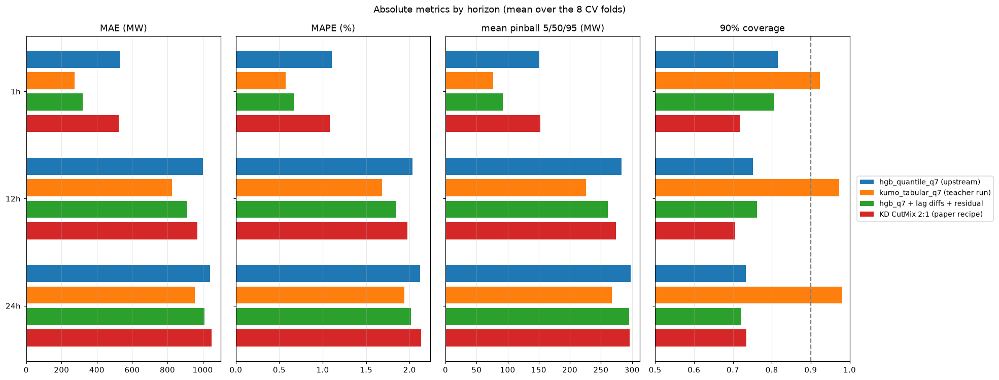
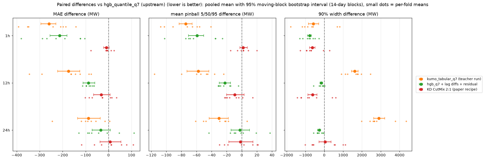
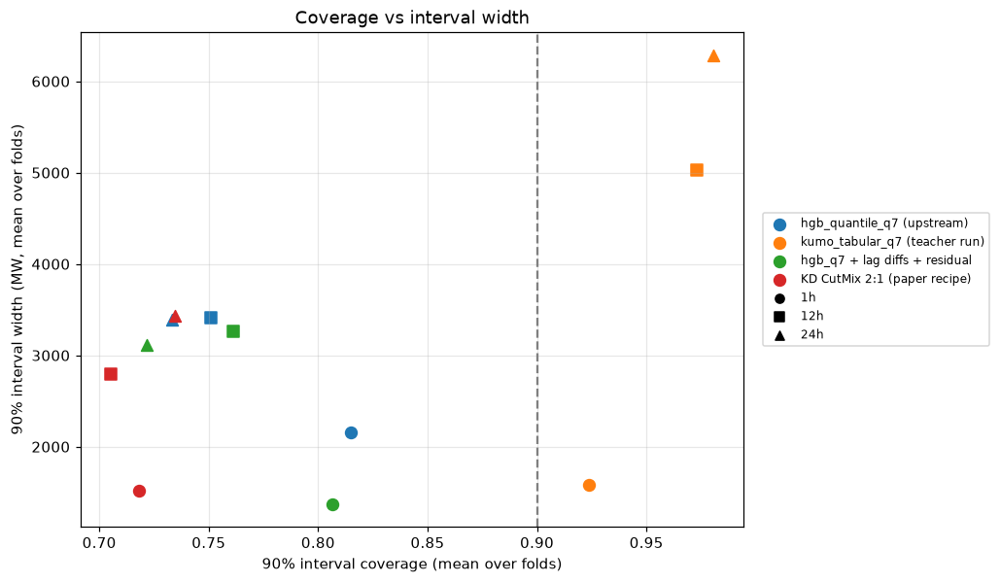
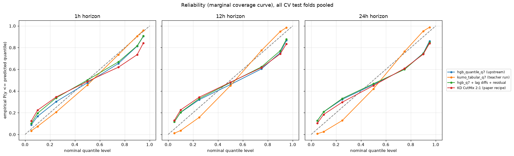
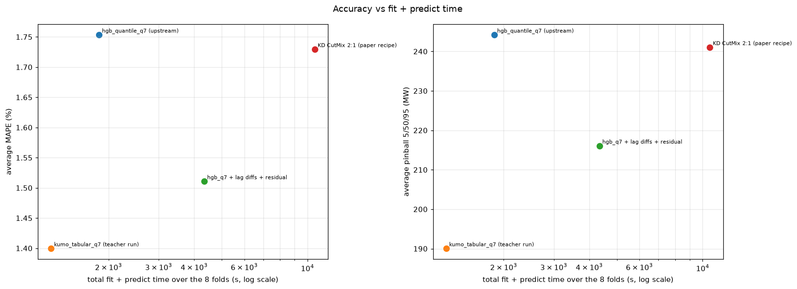
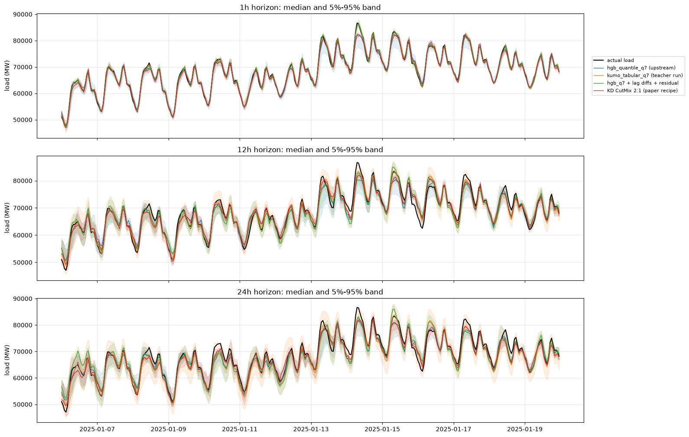
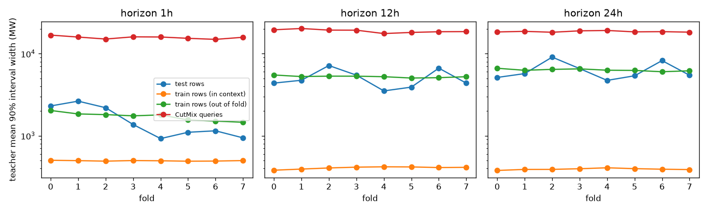

# 02: Distilling Kumo-Tabular into HGB quantile students (intermediate)

Goal: fit one `HistGradientBoostingRegressor(loss="squared_error")` per
quantile level (0.05, 0.1, 0.25, 0.5, 0.75, 0.9, 0.95) on the quantile
predictions of the Kumo-Tabular teacher of [iteration 01](../01-reproduction/report.md),
following the recipe of [arXiv:2610.01435](https://arxiv.org/html/2610.01435),
and check how much of the gap between `hgb_quantile_q7` and `kumo_tabular`
the students close.

Status: intermediate. The paper recipe, the teacher diagnostics and the
single-fold probes are complete. Several full CV runs were still going when
this was written: real rows only, out-of-fold teacher targets, and the
lag-difference features combined with distillation. They will be added in a
later iteration.

## Setup

- Teacher (`scripts/gen_teacher.py`, L4 GPU): for each of the 12 walk-forward
  folds (the 8 evaluation folds plus 4 earlier folds used only for
  calibration, see [iteration 03](../03-calibration/report.md)) and each
  horizon, Kumo-Tabular (8 estimators, fp16, the full training set as context)
  predicts the 7 quantiles on the test rows, on the training rows, and on
  4 x n_train CutMix queries (the students below use the first 2 x n_train).
- CutMix queries (`folds.cutmix`, paper appendix A): each feature of a
  synthetic row is copied, with probability 0.5, from one of two training rows
  drawn uniformly at random.
- Student (`scripts/distill.py`): one HGB per level, `squared_error` loss,
  learning rate 0.1, 31 leaves, `min_samples_leaf=20`, up to 3,000 iterations
  with early stopping (patience 100). Following the paper, the targets are the
  teacher quantiles only (alpha = 1, no ground-truth labels). The synthetic
  to real ratio is 2:1, and the real and synthetic groups get the same total
  weight. The 7 predictions are sorted to remove quantile crossings.
- `hgb_q7 + lag diffs + residual` (`--supervision labels --residual
  --lag_diffs`) is a label-trained pinball-loss baseline that came out of the
  capacity probes. It appends the differences between consecutive hourly load
  lags and `lag_h - lag_{24,48,168}`, which axis-aligned trees cannot form,
  and regresses the target minus the load at prediction time (`lag_h`).

## Results (8 evaluation folds)

| model | MAE avg | MAE 1h | MAE 12h | MAE 24h | MAPE avg (%) | pinball 5/50/95 avg | pinball q7 avg | d2 pinball avg | cov 90 avg | width 90 avg | cov 50 avg | fit+predict (s) |
|---|---:|---:|---:|---:|---:|---:|---:|---:|---:|---:|---:|---:|
| hgb_quantile_q7 (upstream) | 859 | 534 | 1001 | 1042 | 1.75 | 244 | 278 | 0.8595 | 0.766 | 2987 | 0.305 | 1851 |
| kumo_tabular_q7 (teacher run) | 686 | 275 | 827 | 955 | 1.40 | 190 | 213 | 0.8918 | 0.959 | 4298 | 0.594 | 1255 |
| hgb_q7 + lag diffs + residual | 747 | 320 | 913 | 1008 | 1.51 | 216 | 245 | 0.8742 | 0.763 | 2583 | 0.297 | 4336 |
| KD CutMix 2:1 (paper recipe) | 847 | 524 | 969 | 1049 | 1.73 | 241 | 273 | 0.8625 | 0.719 | 2584 | 0.286 | 10608 |

The fit+predict time of the distilled student adds 4,108 s of L4 teacher
time and 6,488 s of student fits on 4 vCPUs. The teacher time covers the fit
plus the predictions on the training rows and on the 2 x n_train synthetic
queries. All 7 x 24 student fits ran the full
3,000 iterations. Predicting the 8 test folds with the students takes 12 s in
total.

- The paper recipe closes only 7% of the MAE gap between `hgb_quantile_q7`
  and the teacher (847 vs 859 and 686 MW). It gains 5 MW of q7 pinball loss
  (273 vs 278 MW), against 65 MW for the teacher. The paired bootstrap
  intervals of the MAE difference contain 0 at every horizon (1h: -10 MW,
  95% interval [-21, 2]).
- The students under-cover more than `hgb_quantile_q7`: 0.72 vs 0.77 for the
  90% intervals, while the teacher over-covers (0.96).
- The largest gap is at 1h (524 vs 275 MW). Without distillation, the lag
  difference features and the residual target get 1h down to 320 MW and
  close 65% of the average MAE gap (747 MW).

## Why the paper recipe does not transfer here

`scripts/teacher_diagnostics.py` compares the teacher predictions on the test
rows, on its own (in-context) training rows, on blocked out-of-fold training
rows, and on the CutMix queries. Averages over the 8 evaluation folds
([teacher_diagnostics.json](teacher_diagnostics.json)):

| horizon | test MAE | test width 90 | test cov 90 | in-context train MAE | in-context width 90 | in-context cov 90 | out-of-fold train MAE | out-of-fold width 90 | out-of-fold cov 90 | CutMix width 90 |
|---|---:|---:|---:|---:|---:|---:|---:|---:|---:|---:|
| 1h | 275 | 1577 | 0.924 | 51 | 494 | 0.998 | 319 | 1717 | 0.917 | 15765 |
| 12h | 827 | 5029 | 0.973 | 35 | 405 | 1.000 | 1074 | 5254 | 0.947 | 18933 |
| 24h | 955 | 6289 | 0.981 | 35 | 391 | 1.000 | 1245 | 6330 | 0.945 | 18613 |

1. **The teacher memorizes its context rows.** With the full training set as
   context, Kumo-Tabular returns almost the label of each training row: median
   error 35-51 MW and intervals 4 to 16 times narrower than on test rows. The
   paper's teacher is a tabular foundation model on i.i.d. data. Here the
   neighbours of a training row one hour apart are in the context with their
   labels, while at test time the closest context row is at least 7 days
   away. Real-row teacher targets are therefore close to the labels for the
   median and much too narrow for the tails.
2. **CutMix queries are far off the data manifold.** Mixing features of two
   random hours produces load lags, rolling statistics, weather forecasts and
   calendar columns that do not belong to one coherent time point. The
   teacher answers with very wide intervals (16-19k MW, 3 to 10 times the test
   width). Once they get half of the training weight, these targets widen the
   student's tails, but in regions that the test rows do not visit.
3. **Out-of-fold teacher predictions do look like test predictions.**
   `scripts/gen_teacher_oof.py` cuts each training set into 4 contiguous
   blocks. It predicts each block with a context that excludes the block and
   7 days on each side of it, which mimics the test-time gap. Their error,
   width and coverage match the test statistics (table above). This makes
   them better targets for the real rows. A full CV run with these targets is
   in progress.

Two more structured query generators were run as teachers on fold 0 to check
point 2: CutMix over feature groups (lags, weather, calendar) and CutMix of
two rows at most 72 h apart. They reduce the teacher width on synthetic rows
to 5.5-8.5k MW, which is still 1.5 to 3.5 times the test width.

## Fold 0, horizon 1h probes

Students fitted on fold 0 at 1h (2,184 test rows; teacher MAE 368 MW) with
the default student hyper-parameters. Predictions are in `results/raw/probe`.

| student | real-row targets | synthetic ratio | residual target | MAE | pinball q7 | cov 90 | width 90 |
|---|---|---:|---|---:|---:|---:|---:|
| labels, pinball loss | labels | 0 | no | 567 | 198 | 0.68 | 1533 |
| labels, pinball loss | labels | 0 | yes | 605 | 218 | 0.60 | 1230 |
| KD | in-context teacher | 0 | no | 563 | 226 | 0.41 | 633 |
| KD | in-context teacher | 1 | no | 569 | 183 | 0.79 | 1882 |
| KD | in-context teacher | 2 | no | 571 | 188 | 0.76 | 1772 |
| KD | in-context teacher | 4 | no | 562 | 184 | 0.76 | 1808 |
| KD | in-context teacher | 0 | yes | 600 | 253 | 0.39 | 526 |
| KD | in-context teacher | 2 | yes | 547 | 181 | 0.75 | 1654 |
| KD | out-of-fold teacher | 0 | no | 585 | 195 | 0.71 | 1593 |
| KD | out-of-fold teacher | 2 | no | 576 | 176 | 0.86 | 2329 |

- With in-context targets and no synthetic rows, the student learns the
  memorized, collapsed intervals (90% coverage 0.41). CutMix rows mostly act
  as a source of width: the ratio barely changes the median MAE (562-571 MW)
  and improves the pinball loss mainly by widening the tails.
- Out-of-fold real-row targets fix the collapse on their own (coverage 0.71).
  Combined with CutMix 2:1 they give the best pinball loss of the probes
  (176 vs 198 MW for the label-trained model).
- None of the students gets close to the teacher's 368 MW median error on
  this fold. On the full CV, the lag-difference features reduce the 1h
  error much more than teacher supervision does (320 vs 524 MW).
