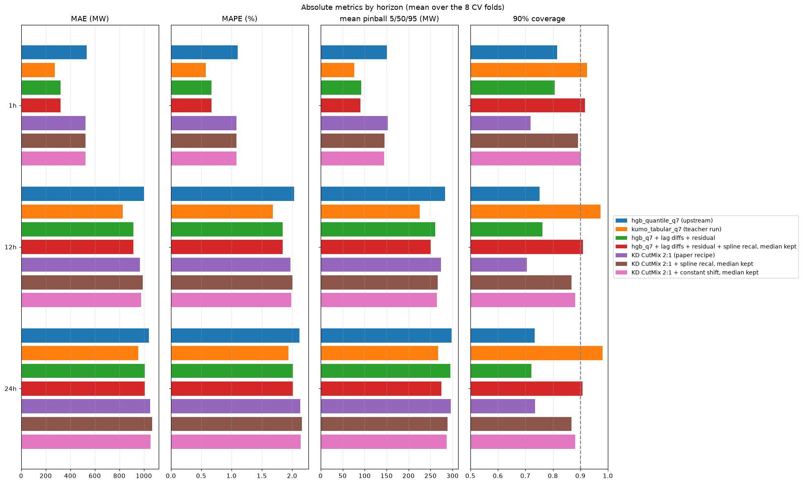
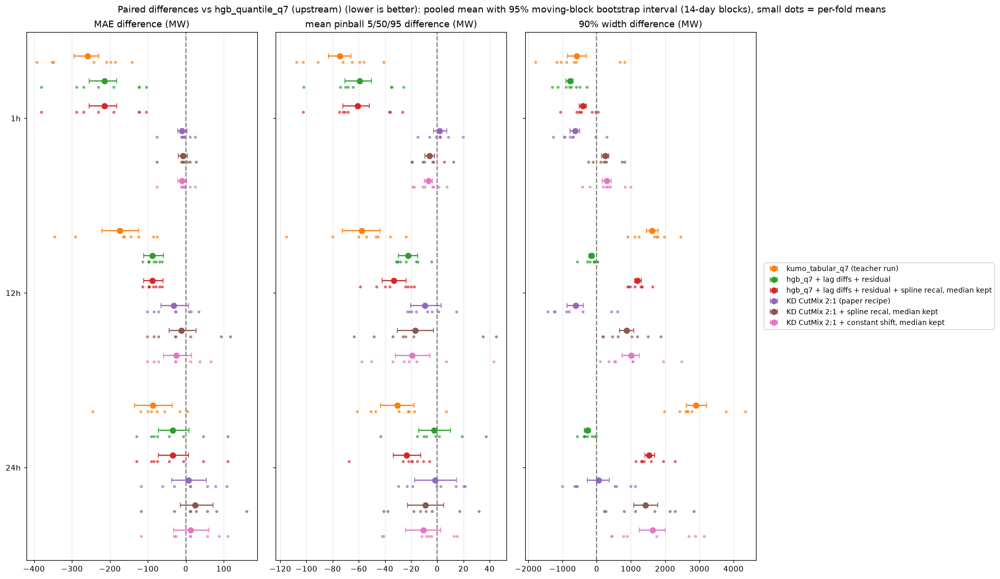
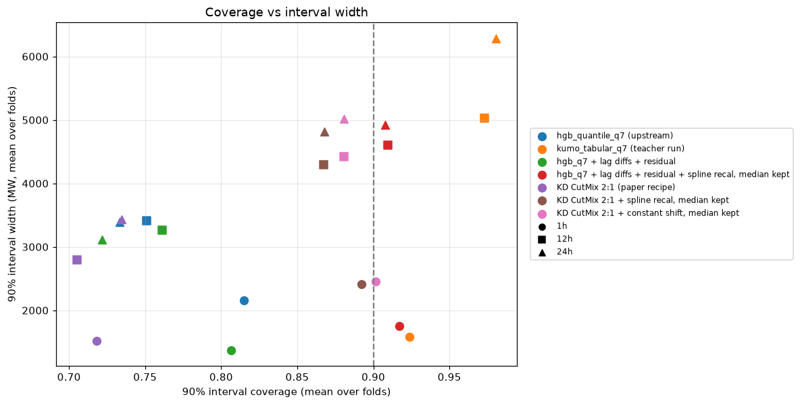
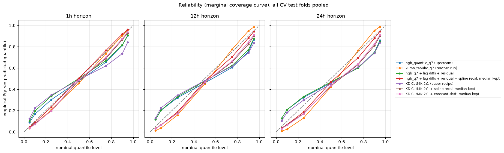
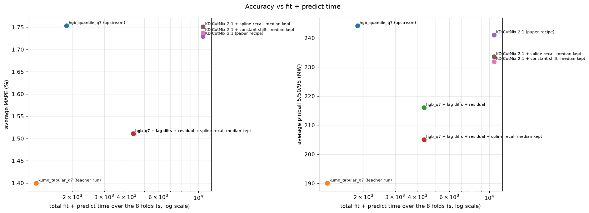
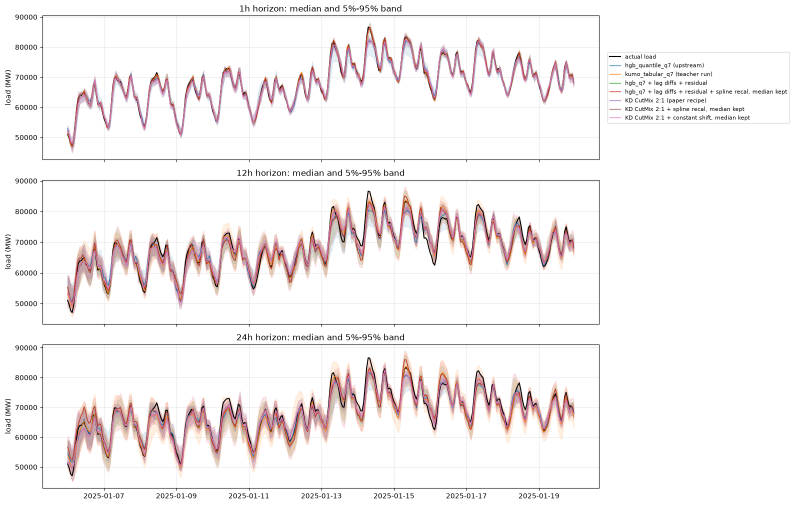

# 03: Post-hoc calibration on top of distillation (intermediate)

Goal: check whether recalibrating the quantiles after the fact helps the
distilled students, the label-trained HGB, and the Kumo-Tabular teacher.

Status: intermediate. This covers the paper-recipe student of
[iteration 02](../02-distillation/report.md), the label-trained
`hgb_q7 + lag diffs + residual` model, and the teacher. The students still
running will be added later.

## Method

`scripts/calibrate.py` recalibrates outer fold k from the predictions of the
4 preceding walk-forward folds (k-4 to k-1, `folds.extended_splits` with
`min_train_days=365`). It only uses their rows before the 7-day gap of fold k.
Each of those models was trained on data that precedes its own test block,
so no information from fold k leaks into the shift. This replaces the inner
CV of the upstream `Recalibrator`, which would have to re-run the teacher
4 more times per fold. Four variants:

- spline recal: the upstream `Recalibrator._fit_shift_model` (10 bins of the
  predicted value, residual quantile per bin, spline + `RidgeCV`). It is
  fitted per quantile level and horizon and added to the predictions;
- constant shift: one shift per level, the empirical level-q quantile of the
  past residuals (conformalized quantile regression);
- median kept: the same two methods without shifting the 0.5 level.

The 7 corrected levels are then sorted. When the shifts of the 0.25 and 0.75
levels are large, sorting can move them past the median, which is why some
"median kept" rows still change the MAE.

## Results (8 evaluation folds)

| model | MAE avg | MAE 1h | MAE 12h | MAE 24h | MAPE avg (%) | pinball 5/50/95 avg | pinball q7 avg | d2 pinball avg | cov 90 avg | width 90 avg | cov 50 avg |
|---|---:|---:|---:|---:|---:|---:|---:|---:|---:|---:|---:|
| hgb_quantile_q7 (upstream) | 859 | 534 | 1001 | 1042 | 1.75 | 244 | 278 | 0.8595 | 0.766 | 2987 | 0.305 |
| kumo_tabular_q7 (teacher run) | 686 | 275 | 827 | 955 | 1.40 | 190 | 213 | 0.8918 | 0.959 | 4298 | 0.594 |
| kumo_tabular_q7 + spline recal | 820 | 291 | 1009 | 1158 | 1.64 | 212 | 239 | 0.8875 | 0.859 | 3209 | 0.445 |
| kumo_tabular_q7 + spline recal, median kept | 715 | 276 | 868 | 1003 | 1.45 | 194 | 227 | 0.8920 | 0.859 | 3210 | 0.460 |
| kumo_tabular_q7 + constant shift | 789 | 284 | 966 | 1116 | 1.61 | 204 | 229 | 0.8906 | 0.883 | 3492 | 0.469 |
| kumo_tabular_q7 + constant shift, median kept | 698 | 275 | 842 | 978 | 1.43 | 189 | 220 | 0.8945 | 0.883 | 3493 | 0.488 |
| hgb_q7 + lag diffs + residual | 747 | 320 | 913 | 1008 | 1.51 | 216 | 245 | 0.8742 | 0.763 | 2583 | 0.297 |
| hgb_q7 + lag diffs + residual + spline recal | 768 | 320 | 945 | 1040 | 1.55 | 209 | 233 | 0.8845 | 0.911 | 3761 | 0.520 |
| hgb_q7 + lag diffs + residual + spline recal, median kept | 747 | 320 | 913 | 1008 | 1.51 | 205 | 232 | 0.8854 | 0.911 | 3761 | 0.520 |
| hgb_q7 + lag diffs + residual + constant shift | 764 | 320 | 936 | 1034 | 1.54 | 209 | 234 | 0.8833 | 0.913 | 3759 | 0.518 |
| hgb_q7 + lag diffs + residual + constant shift, median kept | 747 | 320 | 913 | 1008 | 1.51 | 206 | 233 | 0.8840 | 0.913 | 3759 | 0.518 |
| KD CutMix 2:1 (paper recipe) | 847 | 524 | 969 | 1049 | 1.73 | 241 | 273 | 0.8625 | 0.719 | 2584 | 0.286 |
| KD CutMix 2:1 + spline recal | 956 | 557 | 1109 | 1202 | 1.92 | 249 | 279 | 0.8672 | 0.876 | 3839 | 0.465 |
| KD CutMix 2:1 + spline recal, median kept | 861 | 525 | 990 | 1067 | 1.75 | 234 | 269 | 0.8711 | 0.876 | 3839 | 0.479 |
| KD CutMix 2:1 + constant shift | 937 | 541 | 1086 | 1184 | 1.91 | 246 | 275 | 0.8676 | 0.888 | 3963 | 0.477 |
| KD CutMix 2:1 + constant shift, median kept | 852 | 524 | 976 | 1055 | 1.74 | 232 | 267 | 0.8712 | 0.888 | 3963 | 0.488 |

The calibration fits take less than 1 s per fold.

- Never shift the median. Shifting it with past-fold residuals adds 17 to
  134 MW of MAE for every model. The level of the load drifts between folds
  (seasons), so a past median bias does not carry over to the next 13 weeks.
- Leaving the median alone, calibration helps the under-covering HGB models.
  The 90% coverage goes from 0.72-0.76 to 0.88-0.91 and the q7 pinball loss
  drops by 4-6 MW for the KD student (273 to 267-269) and by 12-13 MW for
  `hgb_q7 + lag diffs + residual` (245 to 232).
- For the over-covering teacher, calibration narrows the intervals (90%
  coverage 0.96 to 0.86-0.88). It barely changes the 5/50/95 pinball loss
  (190 to 189-194) and worsens the q7 pinball loss (213 to 220-227). Calibrating
  Kumo-Tabular does not help on this problem.
- Calibration does not change the ranking. The best HGB model so far is the
  label-trained `hgb_q7 + lag diffs + residual + spline recal, median kept`:
  MAE 747 MW, q7 pinball 232 MW, 90% coverage 0.91. The calibrated
  paper-recipe student stays at 852-861 MW and 267-269 MW.

